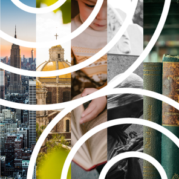

---
title:
weight: 1
resources:
  - src: season63.png
    title: Season 63
---

## [Season 63:](/concerts) The Poet Sings

This season, our 63rd, Schola Cantorum delves into the union between poetry and music inherent in almost all choral works. We’ll explore how music, lyrics, and voices create works of art greater than the sum of their parts.

This season spans the full range of choral music: stories we share (_Broadway Sings_), a centuries-old tradition reimagined in Spanish (_El Mesías_), holiday celebrations for the whole family (_A Storybook Holiday_), towering works by Mozart and Brahms (_Sacred Masterworks_), and poetry from Shakespeare to today (_The Poet Speaks_). What unites them all is the propulsive combination of music and words: melody, harmony, and poetry.

We cap off our season with an as-yet to be commissioned work to be premiered at ***The Poet Speaks*** concert, based on this fall’s winning poem from our 4th Poetry to Music competition.

<a href="/concerts#subscription" class="btn btn-primary">Buy Subscription</a>

Beyond our subscription series, two special events round out the year.
Join us for a diamond celebration at our [60th Messiah Sing](/events/messiah-sing),
a beloved holiday tradition where everyone is invited to sing along. In April,
we join Redwood Symphony for Stravinsky’s [_Symphony of Psalms_](/concerts/symph-psalms) as part of their Stravinsky Festival. Both are ticketed separately and aren’t included in a Season 63 FlexPASS Subscription.