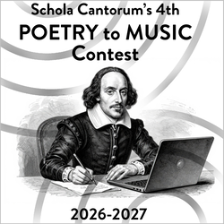

**Calling all teen poets!** Santa Clara County students in grades 9–12 can submit an original poem on ***Belonging: finding your place in the world***. Acclaimed composer Maria Thompson Corley will set the winner for choir, premiering at _The Poet Speaks_ on May 23, 2027. Free to enter. **Deadline: Mon., Nov. 16, 11pm PT.** [Contest details](/poetry)